


 

&nbsp;
&nbsp;

  

**[About](#about)** &nbsp;·&nbsp; **[Expertise](#capabilities)** &nbsp;·&nbsp; **[Cypraon](#cypraon)** &nbsp;·&nbsp; **[Projects](#projects)** &nbsp;·&nbsp; **[Engineering](#engineering)** &nbsp;·&nbsp; **[Analytics](#analytics)** &nbsp;·&nbsp; **[Contact](#connect)**

 

I build business software: the databases, data pipelines and reporting layers that make operations measurable, and the applications that sit on top of them. My work starts with a bottleneck in how a business runs, then moves to a data model, an architecture and an automated flow that removes it.

I work as an Enterprise Solutions Advisor and Technology Consultant with [Cypraon Private Limited](https://cypraon.com), and I develop my own product initiatives alongside that work.

> *"Digitization without optimization is just automated friction."*

 

<table>
<tr>
<td width="33%" valign="top">

**Enterprise software** 
ERP and CRM solutions, Manufacturing Execution Systems, system design and integration.

</td>
<td width="33%" valign="top">

**Database and data engineering** 
SQL Server, T-SQL, SSIS, stored procedures, indexing, query optimization, ETL and data migration.

</td>
<td width="33%" valign="top">

**Business intelligence** 
Power BI, Power Query, advanced Excel, MIS reporting automation and business dashboards.

</td>
</tr>
<tr>
<td valign="top">

**Business process automation** 
Replacing manual hand-offs and spreadsheet chains with reliable, auditable workflows.

</td>
<td valign="top">

**Backend and SaaS architecture** 
Python, Node.js, NestJS and Django services; PostgreSQL, MySQL, MongoDB and Supabase.

</td>
<td valign="top">

**AI-powered business solutions** 
Applying AI tooling to operational problems such as reporting, content and customer workflows.

</td>
</tr>
</table>

 


[Cypraon Private Limited](https://cypraon.com) is an enterprise technology company. I am associated with Cypraon as **Enterprise Solutions Advisor & Technology Consultant**. This profile is my personal engineering portfolio; Cypraon's own work and branding live at [cypraon.com](https://cypraon.com).

| Practice area | Scope |
|:--|:--|
| ERP and CRM | Implementation, customization and data migration between platforms |
| MES and manufacturing automation | Shop-floor data capture, production tracking and reporting |
| Solar and renewable energy systems | Software and data management for the renewable sector |
| Database and software engineering | Schema design, performance tuning, custom application development |
| Enterprise consulting | Process review, solution architecture and technology selection |
| Business process automation | Workflow automation and MIS reporting |

**Website:** [cypraon.com](https://cypraon.com) &nbsp;·&nbsp; **Enterprise enquiries:** [info@cypraon.com](mailto:info@cypraon.com)

 

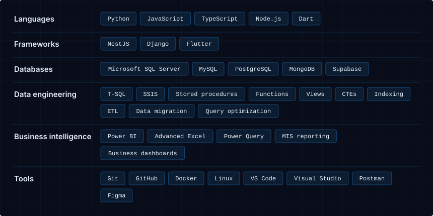

 

These are product initiatives I am developing. Repository and demo links will be added here as each one is published.


| | |
|:--|:--|
| **Problem** | Business data is spread across systems, and decisions wait on manual reporting. |
| **Idea** | One layer that connects operational data, keeps it consistent and turns it into answers and actions. |
| **Focus** | Data integration, business intelligence, automated reporting. |
| **Status** | Product initiative |


| | |
|:--|:--|
| **Problem** | Running social media for a brand means juggling planning, content, publishing and reporting by hand. |
| **Idea** | An AI-assisted workspace that handles the operational side of social media in one place. |
| **Focus** | AI-assisted content workflows, scheduling, performance reporting. |
| **Status** | Product initiative |


| | |
|:--|:--|
| **Problem** | Local service providers and neighbourhood businesses have limited digital reach. |
| **Idea** | A platform that connects local services with customers and supports digital commerce. |
| **Focus** | Local discovery, service booking, digital commerce. |
| **Status** | Product initiative |

**Other repositories**

| Repository | Language | Topic |
|:--|:--|:--|
| [whatsapp_clone_jeet](https://github.com/byjeetrathod2k3/whatsapp_clone_jeet) | Dart | WhatsApp clone |
| [Finance_Dashboard](https://github.com/byjeetrathod2k3/Finance_Dashboard) | | Finance dashboard |
| [Cat-Dog-Classification](https://github.com/byjeetrathod2k3/Cat-Dog-Classification) | Jupyter Notebook | Image classification |
| [Wheather-Data-Analysis](https://github.com/byjeetrathod2k3/Wheather-Data-Analysis) | HTML | Weather data analysis |
| [cypraon-website-screenshot-tool](https://github.com/byjeetrathod2k3/cypraon-website-screenshot-tool) | Python | Website screenshot utility |

 


| Principle | How I apply it |
|:--|:--|
| **Architecture** | Start from the business process, then choose the simplest structure that can grow. |
| **Security** | Least-privilege access, no secrets in code, and review of anything that touches business data. |
| **Scalability** | Design schemas and queries for the data volume the business will have, not the volume it has today. |
| **Data integrity** | Constraints, validation and reconciliation checks so reports can be trusted. |
| **Clean code** | Readable, documented and consistent, so the next engineer can change it safely. |
| **Testing** | Verify migrations, calculations and integrations before they reach users. |
| **User experience** | Software that staff can use without training manuals. |

 

<table>
<tr>
<td width="50%" align="center">
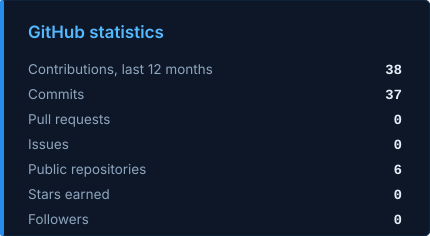
</td>
<td width="50%" align="center">
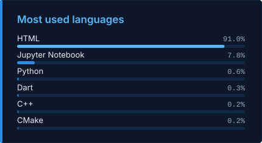
</td>
</tr>
</table>

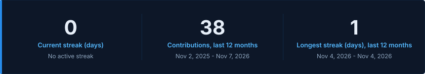

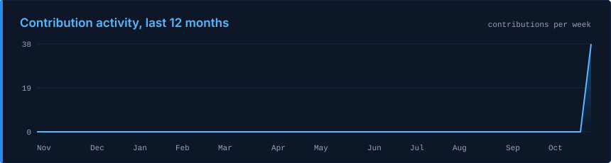

 

<picture>
  <source media="(prefers-color-scheme: dark)" srcset="https://raw.githubusercontent.com/byjeetrathod2k3/byjeetrathod2k3/output/github-contribution-grid-snake-dark.svg">
  <source media="(prefers-color-scheme: light)" srcset="https://raw.githubusercontent.com/byjeetrathod2k3/byjeetrathod2k3/output/github-contribution-grid-snake.svg">
  
</picture>

 

- Building **ABIOS**, **Hubly.ai** and **TownTap** as product initiatives
- Data engineering and business intelligence for enterprise reporting
- ERP, CRM and MES solutions through Cypraon
- AI-powered business solutions and automation
- Solar and renewable energy software solutions
- SaaS architecture and backend engineering

 

| | |
|:--|:--|
| **GitHub** | [github.com/byjeetrathod2k3](https://github.com/byjeetrathod2k3) |
| **LinkedIn** | [linkedin.com/in/jeet-rathod-lnkd](https://linkedin.com/in/jeet-rathod-lnkd) |
| **Cypraon** | [cypraon.com](https://cypraon.com) |
| **Enterprise enquiries** | [info@cypraon.com](mailto:info@cypraon.com) |

 

